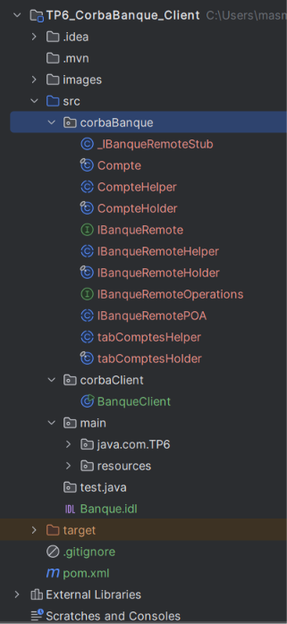
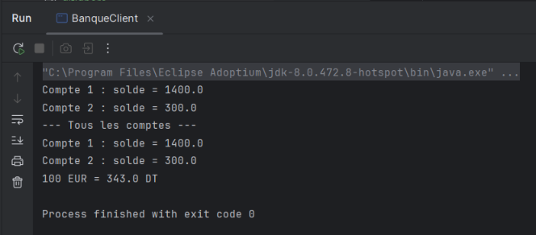

# TP 6 : Service Banque avec CORBA — Projet Client

**Projet :** `TP6_CorbaBanque_Client`
**Technologies :** Java 8 (JDK 8), CORBA, IDL (`idlj`), JNDI

---

## Objectif

Développer le côté **client** d'une application répartie CORBA : retrouver l'objet distant `IBanqueRemote` publié par le serveur sous le nom `BK` et appeler ses méthodes à distance.

## Structure du projet


---

## Étape 1 : Préparation du projet

- Projet Maven IntelliJ `TP6_CorbaBanque_Client`, **JDK 8**.
- Dans `pom.xml` : `maven.compiler.source/target = 8` et `<sourceDirectory>src</sourceDirectory>`, comme celui du projet Server.
- Copie depuis le projet serveur de :
    - `Banque.idl` dans `src/` ;
    - `jndi.properties` dans `src/main/resources/` :

```properties
java.naming.factory.initial=com.sun.jndi.cosnaming.CNCtxFactory
java.naming.provider.url=iiop://localhost:900
```

**Synthèse :** le client part du même contrat IDL que le serveur, c'est ce qui garantit que les deux côtés se comprennent.

---

## Étape 2 : Génération du code client

Depuis le dossier `src` :

```bat
idlj -fall -v Banque.idl
```


Le package `corbaBanque` est généré dans le projet client :


**Synthèse :** `idlj` produit côté client le stub (`_IBanqueRemoteStub`) et les classes Helper/Holder, nécessaires pour appeler l'objet distant.

---

## Étape 3 : Client `corbaClient/BanqueClient.java`

1. Création du contexte JNDI : `new InitialContext()`
2. Récupération de la référence distante : `ctx.lookup("BK")`
3. Création du stub : `IBanqueRemoteHelper.narrow((org.omg.CORBA.Object) ref)`
4. Appels des méthodes distantes :
    - création des comptes 1 (1000) et 2 (500) ;
    - versement de 400 sur le compte 1 ;
    - retrait de 200 sur le compte 2 ;
    - affichage de chaque compte et de la liste complète ;
    - conversion de 100 EUR en DT.

**Synthèse :** grâce au stub obtenu par `narrow`, les méthodes distantes s'utilisent comme des méthodes locales ; CORBA gère la communication réseau.

---

## Étape 4 : Exécution

Ordre obligatoire : **`tnameserv` → `BanqueServer` (projet serveur) → `BanqueClient`**. Le serveur doit afficher « Serveur prêt » avant le lancement du client.



Résultat : après le versement et le retrait, les soldes sont **1400** (compte 1) et **300** (compte 2), identiques dans `getCompte` et `getComptes`. La conversion de 100 EUR donne **343 DT** (taux de 3,43 défini côté serveur).

**Synthèse :** le client invoque bien les méthodes exécutées sur le serveur, qui conserve l'état des comptes entre les appels.

---

## Conclusion

Le client CORBA retrouve l'objet distant via l'annuaire JNDI et exécute correctement toutes les opérations bancaires à distance.